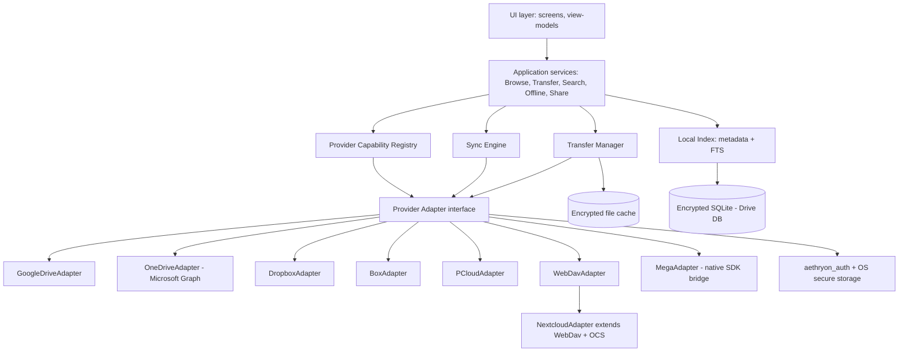

# DRIVE_ARCHITECTURE — Aethryon Drive

পর্যালোচনার তারিখ: ২০২৬-১১-১০ | অবস্থা: PROPOSED (কোনো code বা schema নেই)

## ১. লক্ষ্য
একাধিক cloud storage account-এর জন্য একটি হালকা, local-first file manager। UI কখনো provider জানে না; সবকিছু capability registry ও adapter interface দিয়ে।

## ২. স্তরবিন্যাস

## ৩. Provider adapter interface (ধারণাগত; implementation নয়)
Adapter যা প্রকাশ করবে: `capabilities()` (প্রতি feature-এ status enum), `listChildren(page)`, `getMetadata`, `download(range)`, `upload(resumable session)`, `move/copy/rename`, `trash/restore/permanentDelete`, `share` (capability থাকলে), `search` (capability থাকলে), `changes(cursor)` (capability থাকলে), `quota()`। অ-সমর্থিত operation `UNSUPPORTED` capability দেখিয়ে UI-তে নিষ্ক্রিয় থাকবে; exception ছুড়ে নয়।

## ৪. Capability registry
Registry দুই স্তরের status রাখে: **provider-সামগ্রিক** এবং **feature-ভিত্তিক** (`PROVIDER_COMPATIBILITY_MATRIX.md`)। Registry-র তথ্য (ক) static manifest (গবেষণা থেকে), (খ) runtime probe (যেমন Nextcloud server capabilities) — দুটির মধ্যে runtime অগ্রাধিকার পায়। `UNVERIFIED` capability UI-তে সক্রিয় হবে না।

## ৫. Local database কৌশল (ধারণা; schema নয়)
- Drive-এর **নিজস্ব** SQLite ডাটাবেস; Mail-এর সঙ্গে ফাইল/key ভাগ নয়।
- Encryption: SQLCipher Community Edition (BSD-style লাইসেন্স, attribution বাধ্যতামূলক — S24)। Dart-এ `sqlite3` ৩.x এর মাধ্যমে SQLCipher ব্যবহারের পথ আছে; `sqlcipher_flutter_libs` EOL (S24)। **চূড়ান্ত বাছাই Phase 1 spike-এ**।
- মডেল-ধারণা: account → remote node (id, parent, name, size, mtime, hash(es), provider-etag), sync cursor, transfer job, offline pin, favorite, local FTS (শুধু name/path/ব্যবহারকারী-সক্ষম হলে content-extract নয়)।
- Incremental indexing: প্রথমে শুধু দেখা folder; পটভূমিতে resource-aware crawl।

## ৬. Sync engine
- প্রতি-account, প্রতি-folder সেটিংস: `realtime | background | manual | scheduled`, `wifiOnly`, `meteredPolicy`।
- Change detection ক্রম: (১) provider change-feed/cursor (Dropbox list_folder cursor ও longpoll — S13/S16-ভিত্তিক সেকেন্ডারি; Graph delta — UNVERIFIED; Nextcloud ETag/PROPFIND — UNVERIFIED) → (২) ETag/hash তুলনা → (৩) নির্ধারিত polling।
- **Webhook/push বাধ্যতামূলক নয়:** Dropbox/Graph/Drive webhook-এর জন্য সার্বজনীন HTTPS endpoint লাগে, যা "কোনো বাধ্যতামূলক Aethryon cloud নয়" নীতির সঙ্গে সংঘাত করে; তাই real-time শুধু client-pull (long-poll) বা অ্যাপ খোলা অবস্থায় (PARTIAL)। ঐচ্ছিক relay OPEN।
- Conflict নীতি: কখনো নীরবে overwrite নয়; উভয় সংস্করণ রেখে conflict-copy (নাম নির্দিষ্ট প্যাটার্নে) ও ব্যবহারকারীকে সিদ্ধান্তের সুযোগ।
- Two-way sync একটি পৃথক, অগ্রাধিকার-নিচু feature; Phase 1–2 এ প্রথমে **browse/transfer/offline-pin**; folder-mirror পরে।

## ৭. Transfer manager
- Resumable/chunked: OneDrive (৩২০ KiB-এর গুণিতক chunk — S11), Dropbox (upload session; ≤১৫০ MB প্রতি request, ≤৩৫০ GB ফাইল — S13), Box (chunked session — S14)। Google Drive, pCloud, Nextcloud (chunked v2 আছে বলে manual-এ উল্লেখ — S16), MEGA, WebDAV-এর resumable ধরন: **UNVERIFIED** (Phase 1 provider spike)।
- Concurrency সীমা resource-aware (৪ GB RAM-এ ২ সমান্তরাল ডিফল্ট — PROPOSED)। Streaming I/O; পুরো ফাইল RAM-এ নয়।
- Duplicate download/upload এড়ানো: content-hash ও provider-etag ভিত্তিক dedupe।
- Rate-limit governor: Box ~১০০০ request/মিনিট/ব্যবহারকারী, upload ২৪০/মিনিট (S14); Dropbox সংখ্যা অপ্রকাশিত → 429 + `Retry-After` মেনে adaptive।

## ৮. Cache
Encrypted file cache, LRU, ব্যবহারকারী-নির্ধারিত সর্বোচ্চ আকার, "offline pin" cache-eviction থেকে মুক্ত। থাম্বনেইল আলাদা ছোট cache। Logout/account-removal-এ cache ও index তাৎক্ষণিক মুছে যাবে।

## ৯. Platform file handling
Android: Storage Access Framework (broad storage permission এড়ানো); iOS: document picker/File Provider (File Provider extension **এই scope-এ নয়**, OPEN); Desktop: native dialog, atomic write (temp → rename)।

## ১০. MEGA-র বিশেষ স্থাপত্য
MEGA end-to-end encrypted; client-side decrypt লাগে, তাই server-side search/preview সীমিত। অফিসিয়াল C++ SDK (BSD-2-Clause লাইসেন্স — S07) native bridge হিসেবে (FFI) ব্যবহারের সম্ভাবনা; ব্যবহারে **application key ও Terms of Service মান্য করা বাধ্যতামূলক** (SDK header — S07)। পুরোনো ToS অনুযায়ী প্রকাশের আগে MEGA-র অনুমোদন লাগত (S08, ২০১৩, archived) — **বর্তমান শর্ত UNVERIFIED**। এটি Phase 1-এর প্রথম blocking গবেষণা। MEGA adapter ঐচ্ছিক module (binary আকার বাঁচাতে আলাদা build flavor — PROPOSED)।

## ১১. Error handling ও retry
শ্রেণি: transient (5xx, timeout) → exponential backoff + jitter; throttled (429/`Retry-After`) → governor; auth (401/invalid_grant) → re-auth flow, অন্য account প্রভাবিত নয়; permanent (4xx) → ব্যবহারকারীকে স্পষ্ট বার্তা। প্রতিটি job idempotent ও resume-যোগ্য।

## ১২. Account isolation
প্রতি account-এর আলাদা token, আলাদা sync queue, আলাদা rate-limit bucket; এক account-এর ব্যর্থতা অন্যকে আটকায় না। Account মুছলে: token revoke (provider সমর্থন করলে), local index/cache ও pinned ফাইল (ব্যবহারকারীর নিশ্চিতকরণে) মুছে ফেলা।

## ১৩. Optional AI (ঐচ্ছিক)
উদাহরণ: ফাইল-নাম ভিত্তিক গোছানো-পরামর্শ, duplicate শনাক্ত। ডিফল্ট বন্ধ; চালু করতে স্পষ্ট consent এবং কোন data যাবে তার তালিকা। On-device model বনাম remote API — OPEN। AI বন্ধ থাকলে কোনো feature হারায় না।

## ১৪. Logging/diagnostics
Redacted log (ফাইল-নাম ও token কখনো নয়, শুধু আইডি-হ্যাশ), স্থানীয়; ব্যবহারকারী চাইলে export।

## ১৫. Google-নির্দিষ্ট সীমা
(ক) পূর্ণ Drive browse-এর জন্য `drive`/`drive.readonly` restricted scope; সংশ্লিষ্ট verification ও সম্ভাব্য বার্ষিক security assessment (S01, S02)। (খ) `drive.file` non-sensitive, কিন্তু শুধু ব্যবহারকারী-নির্বাচিত/অ্যাপ-তৈরি ফাইলে — সম্পূর্ণ file-manager হিসেবে অপর্যাপ্ত (S01)। (গ) Restricted scope শুধু নির্দিষ্ট ধরনের অ্যাপে অনুমোদিত (local sync/backup, productivity, reporting); Aethryon কোন শ্রেণিতে পড়ে তা **Google-এর সিদ্ধান্তসাপেক্ষ — UNVERIFIED** (S01, S03)। (ঘ) storage pooling/sharding নিষিদ্ধ (S03)।
