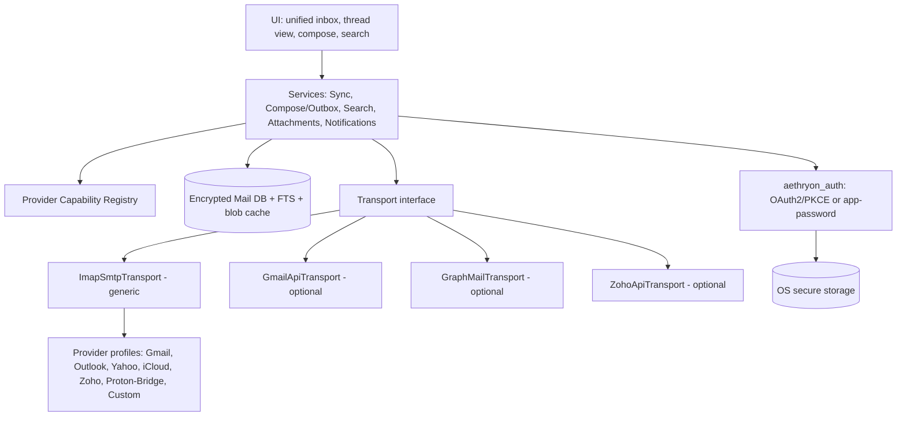

# MAIL_ARCHITECTURE — Aethryon Mail

পর্যালোচনার তারিখ: ২০২৬-১১-১০ | অবস্থা: PROPOSED

## ১. লক্ষ্য
হালকা, local-first, বহু-provider mail client। বিশাল inbox-এ দ্রুত; ব্যাটারি-সচেতন; কোনো বাধ্যতামূলক Aethryon server নয়।

## ২. স্তরবিন্যাস

**মূল কৌশল:** একটি শক্তিশালী generic IMAP/SMTP transport সব provider কে কভার করে; provider-নির্দিষ্ট REST transport শুধু যেখানে স্পষ্ট সুবিধা আছে (সেটি Phase 2+ এ মূল্যায়ন)। এতে binary ছোট ও রক্ষণযোগ্যতা বেশি।

## ৩. Authentication মডেল
| Provider | প্রাথমিক পদ্ধতি | বিকল্প | টীকা |
|---|---|---|---|
| Gmail | OAuth2 + XOAUTH2 (scope `https://mail.google.com/`) — S04 | REST API granular scope (S06, সেকেন্ডারি) | সব ক্ষেত্রেই restricted scope; verification + CASA (S06) |
| Outlook/M365 | OAuth2: `IMAP.AccessAsUser.All`, `SMTP.Send` (+`offline_access`) — S09 | Graph Mail (UNVERIFIED) | Basic auth অপসারণের পথে (S10 — সেকেন্ডারি/বিরোধপূর্ণ) |
| Yahoo | OAuth2 (Yahoo Mail API Access ফর্ম + Commercial Access Agreement লাগতে পারে — S19 সেকেন্ডারি) | App password | IMAP imap.mail.yahoo.com:993, SMTP smtp.mail.yahoo.com:465 (S19 সেকেন্ডারি) |
| iCloud | App-specific password (S18) | — | OAuth নেই (এই session-এ পাওয়া যায়নি; অনুপস্থিতি UNVERIFIED) |
| Zoho | OAuth2 REST (S20); IMAP UNVERIFIED | — | ৭টি data center domain; ব্যবহারকারীর DC অনুযায়ী endpoint |
| Proton | Bridge-এর local IMAP/SMTP credential (S17) | — | **REQUIRES_COMPANION**, শুধু desktop |
| Generic | IMAP/SMTP: OAuth (XOAUTH2) যদি সার্ভার দেয়, নয়তো password/app-password | — | capability probe |

কোনো credential/token plain text-এ নয় (`SECURITY_THREAT_MODEL.md`)।

## ৪. Local store
- Mail-এর **নিজস্ব** encrypted SQLite (Drive-এর থেকে সম্পূর্ণ আলাদা ফাইল ও key)।
- ধারণা-মডেল: account, folder/label mapping, message header, flags, thread map, body/attachment blob store (আকারসীমিত LRU), FTS index, outbox, sync state (UIDVALIDITY/MODSEQ বা history cursor)।
- **Pagination ও lazy loading:** inbox তালিকা header-only; body চাহিদা-অনুযায়ী; attachment কেবল ব্যবহারকারী খুললে বা নীতি অনুযায়ী।
- Incremental indexing: নতুন → পুরোনো ক্রমে, ব্যাটারি/চার্জিং অবস্থা অনুযায়ী থ্রোটল।

## ৫. Sync
- IMAP: `CAPABILITY` পরীক্ষা করে `IDLE`, `CONDSTORE/QRESYNC`, `MOVE`, `THREAD` ইত্যাদি ব্যবহার (RFC-পর্যালোচনা UNVERIFIED — Phase 1)। অনুপস্থিত হলে fallback।
- Provider-স্পেসিফিক ফোল্ডার ব্যবস্থা: Gmail labels বনাম IMAP folders-এর আচরণ আলাদা (Gmail-এর IMAP আচরণ scope ও সেটিং-এ নির্ভর করে — S04); ভুল ম্যাপিং এড়াতে provider profile।
- Thread/conversation: Gmail-এ native থ্রেড (UNVERIFIED বিবরণ); generic IMAP-এ `References/In-Reply-To` ভিত্তিক local threading।
- ব্যবহারকারীর sync মোড: real-time (সমর্থিত হলে), background, manual, scheduled, Wi-Fi-only, metered নীতি।

## ৬. Push/real-time — সবচেয়ে গুরুত্বপূর্ণ সীমা
| Platform | IMAP IDLE | ফলাফল |
|---|---|---|
| Windows/Linux/macOS | সম্ভব (অ্যাপ/ডেমন চললে) | real-time: `FULL` (অ্যাপ চলমান থাকলে) |
| Android | Doze/ব্যাটারি-অপ্টিমাইজেশনে অনির্ভরযোগ্য (S25 সেকেন্ডারি) | `PARTIAL`: foreground service ঐচ্ছিক (ব্যাটারি খরচ ব্যাখ্যা সহ) বা periodic fetch |
| iOS | persistent TCP background-এ অনুমোদিত নয় (S25 সেকেন্ডারি) | `PARTIAL`: background fetch + (ঐচ্ছিক) relay |

**Gmail API push** Cloud Pub/Sub topic লাগে; Gmail সেখানে publish করে; watch প্রতি ≥৭ দিনে নবায়ন করতে হয় (S05)। অর্থাৎ **অ্যাপের মালিকের একটি backend দরকার** — "কোনো বাধ্যতামূলক Aethryon-hosted cloud নয়" নীতির সঙ্গে সরাসরি সংঘাত। অন্য mobile-mail অ্যাপগুলো প্রচলিতভাবে server-এ OAuth token রেখে push দেয় (S25 সেকেন্ডারি)।

**প্রস্তাবিত সমাধান (OPEN — আপনার সিদ্ধান্ত লাগবে):**
1. ডিফল্ট: relay নেই; mobile-এ periodic/background fetch (PARTIAL, সৎভাবে UI-তে জানানো)।
2. ঐচ্ছিক "Privacy-preserving push relay": relay শুধু "নতুন মেইল আছে" সংকেত (ঠিকানা-হ্যাশ + cursor) পাঠায়; **OAuth token বা মেইল-কনটেন্ট relay-তে যায় না**। Gmail-এর ক্ষেত্রে Pub/Sub topic অ্যাপ-মালিকের GCP প্রকল্পে থাকতে বাধ্য, তাই এটি একটি Aethryon-পরিচালিত ঐচ্ছিক উপাদান; self-host করার বিকল্প রাখা যায়। খরচ/অপারেশন দায় — RISK R-09।

## ৭. Compose/Outbox
Offline-এ লেখা সম্ভব; Outbox স্থানীয় ও এনক্রিপ্টেড; পাঠানোর আগে retry নীতি; সীমা: provider-এর পাঠানোর সীমা ও attachment আকার (মান UNVERIFIED — Phase 1 provider spike)। "Undo send" ঐচ্ছিক স্থানীয় বিলম্ব (server-হোল্ড নয়)।

## ৮. Attachment হ্যান্ডলিং
Streaming download, আকারের সতর্কতা, executable/scripts-এ সতর্কতা, কোনো স্বয়ংক্রিয় খোলা নয়, sandboxed preview। Remote image ডিফল্টে লোড হয় না (tracking pixel প্রতিরোধ)। HTML mail-এ JavaScript সম্পূর্ণ বন্ধ।

## ৯. Rendering pipeline (হালকা)
HTML mail → sanitize → সীমিত-CSS renderer। Full browser engine/WebView ডিফল্টে এড়ানো (RAM)। যেখানে অপরিহার্য (জটিল HTML), প্রতি-মেসেজ lazy WebView-এ fallback (OPEN, Phase 2 spike; heavyweight pipeline এড়ানোর নির্দেশ মাথায় রেখে)।

## ১০. Proton Mail
Bridge হলো Proton-এর official desktop সহযোগী অ্যাপ: Windows 10+ (64-bit), macOS, Linux; **মোবাইলে নয়**; শুধু paid plan-এ (S17)। অতএব: Desktop — `REQUIRES_COMPANION`; Android/iOS — `UNSUPPORTED`। Bridge আমরা bundle/redistribute করব না (লাইসেন্স UNVERIFIED); ব্যবহারকারী নিজে install করবেন; অ্যাপ localhost IMAP/SMTP-তে সংযোগ করবে। UI-তে স্পষ্টভাবে লেখা থাকবে।

## ১১. Error handling
Auth ব্যর্থতা → account-স্তরে "পুনরায় সাইন-ইন" (অন্য account-এ প্রভাব নেই); throttling → backoff; TLS ত্রুটি → কখনো নীরবে অনিরাপদ সংযোগ নয়।

## ১২. Optional AI
সারাংশ, drafting-সহায়তা ইত্যাদি ডিফল্ট বন্ধ; প্রতিবার কোন মেইল-অংশ বাইরে যাবে তা স্পষ্ট consent; remote AI বন্ধ থাকলে কোনো মেইল-কনটেন্ট নেটওয়ার্কে যাবে না।

## ১৩. Gmail-নির্দিষ্ট প্রক্রিয়াগত ঝুঁকি
সব মেইল-পাঠযোগ্য Gmail scope **restricted**; verification + বার্ষিক CASA মূল্যায়ন (S06 সেকেন্ডারি; Google-এর primary পৃষ্ঠা S04 অনুযায়ী `mail.google.com` scope-এ অনুমোদনের জন্য পূর্ণ ব্যবহার দেখাতে হবে)। খরচ ও সময় UNVERIFIED → RISK R-01।
