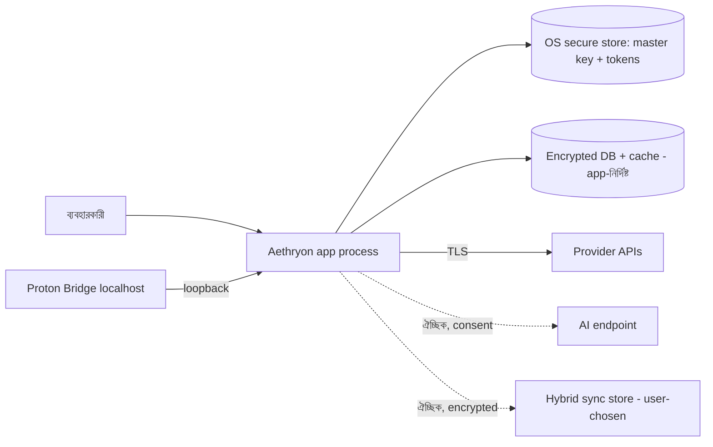

# SECURITY_THREAT_MODEL

পর্যালোচনার তারিখ: ২০২৬-১১-১০ | অবস্থা: PROPOSED (design-level; penetration test নয়)

## ১. সম্পদ (Assets)
OAuth refresh/access token; app-password; ব্যবহারকারীর ফাইল ও মেইল (cache + DB); local DB key; attachment; AI-তে পাঠানো ডেটা; sync/backup export; log/diagnostics।

## ২. বিরোধী (Adversaries)
A1 ডিভাইস চুরি/হারানো; A2 একই ডিভাইসে অন্য অ্যাপ/ব্যবহারকারী/malware; A3 নেটওয়ার্ক MITM; A4 ক্ষতিকর মেইল/ফাইল (phishing, tracking, exploit); A5 compromised provider API/response; A6 supply-chain (dependency); A7 ব্যবহারকারীর অসাবধান ভুল (ভুলে মুছে ফেলা); A8 CI/signing key leak।

## ৩. Trust boundary (Mermaid)

## ৪. হুমকি ও প্রশমন (STRIDE-ভিত্তিক)
| ID | হুমকি | বিরোধী | প্রশমন | অবশিষ্ট ঝুঁকি |
|---|---|---|---|---|
| T1 | Token চুরি | A1,A2 | Token শুধু OS secure store-এ; কখনো plain text/log/DB-তে নয়; refresh token rotation (provider অনুযায়ী); দ্রুত revoke ক্ষমতা | Linux-এ secret store অনুপস্থিত হলে দুর্বল (R-12) |
| T2 | DB/cache পড়া | A1,A2 | SQLCipher/সমমানের full-DB encryption; per-app ও per-account key; key OS store-এ wrapped | রান্টাইমে মেমরি-ডাম্প |
| T3 | MITM | A3 | TLS বাধ্যতামূলক; অনিরাপদ fallback নয়; (certificate pinning কেবল নিজস্ব endpoint-এ — provider-এ pinning ভাঙার ঝুঁকি) | কাস্টম IMAP সার্ভারে ব্যবহারকারী-ভুল |
| T4 | ক্ষতিকর মেইল/ফাইল | A4 | JS নিষ্ক্রিয়; remote content ডিফল্টে বন্ধ; sanitizer; sandboxed preview; attachment স্বয়ংক্রিয় খোলা নয় | জটিল HTML-এ sanitizer bypass |
| T5 | Account মিশে যাওয়া | — | Account isolation: আলাদা queue/key/rate-bucket; এক account-এর ত্রুটি অন্যে নয় | — |
| T6 | Dependency দূষণ | A6 | লকফাইল, বিশ্লেষণ, নূন্যতম dependency, নতুন release-এ কুলিং-পিরিয়ড (CI নীতি); SBOM | zero-day |
| T7 | Signing key/secrets leak | A8 | GitHub Actions secrets, environment protection, আলাদা release key; keystore ব্যাকআপ অফলাইনে | মানব ভুল |
| T8 | ভুলে destructive action | A7 | নিশ্চিতকরণ; trash-first; undo উইন্ডো; permanent delete-এ পুনরায় নিশ্চিতকরণ; recoverability সম্ভব না হলে স্পষ্ট সতর্কতা | provider-স্তরে অপরিবর্তনীয় ক্ষেত্র |
| T9 | Log থেকে তথ্য ফাঁস | A2 | Redacting logger; ফাইল-নাম/ঠিকানা/বিষয়-লাইন লগে নয়; export শুধু সম্মতিতে | — |
| T10 | AI-তে অনিচ্ছাকৃত ডেটা-প্রেরণ | — | ডিফল্ট বন্ধ; feature-ভিত্তিক consent; কোন ডেটা যাবে তার প্রিভিউ; per-account অপ্ট-আউট; AI বন্ধ = শূন্য নেটওয়ার্ক কল | ব্যবহারকারী-অনুমোদিত তথ্য তৃতীয় পক্ষে |
| T11 | Backup/export চুরি | A1 | Export ডিফল্টে এনক্রিপ্টেড (ব্যবহারকারী-পাসফ্রেজ); token কখনো export-এ নয় | দুর্বল পাসফ্রেজ |
| T12 | Hybrid sync-এ ফাঁস | A3,A5 | End-to-end encryption; sync-স্টোরের কাছে plaintext/key নেই; প্রোটোকল নকশা Phase 3 | — |
| T13 | Redirect/URI hijack (OAuth) | A2 | PKCE, state/nonce, loopback বা claimed-scheme; embedded WebView নয় | custom-scheme দখল (পুরোনো OS) |
| T14 | Relay (ঐচ্ছিক push) | A5 | Relay-তে token/কনটেন্ট নয়; শুধু সংকেত; self-host বিকল্প; OPEN ADR-007 | মেটাডাটা (কখন মেইল এল) |
| T15 | Proton Bridge loopback দখল | A2 | Bridge credential ব্যবহারকারীর; লোকালহোস্ট-ভিন্ন হোস্টে সংযোগ নয়; অন্য প্রসেস-এর পোর্ট দখলে সতর্কতা | অন্য লোকাল প্রসেস |

## ৫. সংবেদনশীল ডেটার জীবনচক্র
- **তৈরি:** শুধু ব্যবহারকারীর ক্রিয়ায়।
- **সংরক্ষণ:** এনক্রিপ্টেড; ন্যূনতম পরিমাণ (permission/scope minimization — সর্বনিম্ন scope, যেমন Gmail-এ যথাসম্ভব granular; restricted না হলে নয় — তবে IMAP পথে `mail.google.com` বাধ্যতামূলক, S04)।
- **অপসারণ:** Account/অ্যাপ মুছলে তাৎক্ষণিক wipe (DB, cache, token, index) এবং provider-এ token revoke (সমর্থিত হলে)।

## ৬. Permission minimization
Android: broad storage permission নয় (SAF); notifications ঐচ্ছিক; foreground-service ঐচ্ছিক ও ব্যাখ্যাসহ। iOS: প্রয়োজনীয় entitlement-ই। Desktop: sandbox যেখানে সম্ভব।

## ৭. অনুমোদনহীন/অনিশ্চিত
Provider-নির্দিষ্ট token আয়ু ও revocation আচরণ (Box ছাড়া — S14) UNVERIFIED। নিরাপত্তা-ইতিহাস (CVE) সব dependency-র — UNVERIFIED। বাহ্যিক নিরাপত্তা-নিরীক্ষা Phase 5+ (প্রস্তাব)।
