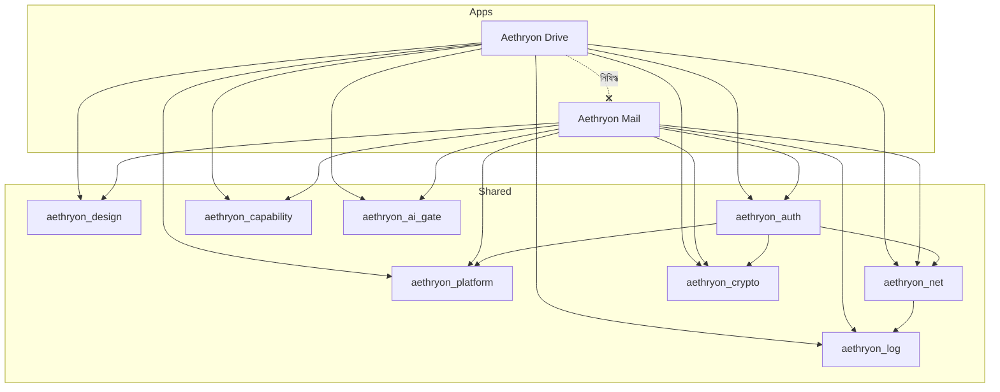

# SHARED_FOUNDATION

পর্যালোচনার তারিখ: ২০২৬-১১-১০ | অবস্থা: PROPOSED

## ১. নীতি
দুটি অ্যাপ **স্বাধীন ভাবে build, release ও চালানো যাবে**। শুধু যে কোড নিরাপদভাবে ভাগ করা যায় এবং যা দুই অ্যাপের sensitive data মেশায় না, তা shared package-এ থাকবে। একটি অ্যাপ বন্ধ বা আনইনস্টল হলে অন্যটি অপ্রভাবিত।

## ২. Shared (অনুমোদিত সীমার ভেতরে)
| Package (প্রস্তাবিত নাম) | বিষয়বস্তু | কেন ভাগযোগ্য |
|---|---|---|
| `aethryon_design` | Design token, theme (light/dark), component, motion নীতি, a11y helper | ভিজ্যুয়াল সামঞ্জস্য |
| `aethryon_platform` | Platform abstraction interface: secure storage, file picker/SAF, connectivity, power/battery state, background scheduler interface | একই OS API |
| `aethryon_net` | HTTP client wrapper, retry/backoff (jitter, `Retry-After`), rate-limit governor, TLS নীতি | সব provider-এ অভিন্ন |
| `aethryon_auth` | OAuth2 Authorization Code + PKCE (RFC 7636), loopback/custom-scheme redirect, token refresh scheduler, **token store interface** | অভিন্ন প্রক্রিয়া |
| `aethryon_crypto` | AEAD wrapper, key derivation, key-wrapping; কোনো নিজস্ব crypto algorithm নয় | audit সহজ |
| `aethryon_log` | Redacting logger, diagnostics bundle (ব্যবহারকারীর সম্মতিতে export) | privacy নীতি অভিন্ন |
| `aethryon_capability` | Capability registry-র **type ও status enum** (§৪ `PROVIDER_COMPATIBILITY_MATRIX`) | অভিন্ন শব্দভাণ্ডার |
| `aethryon_ai_gate` | AI consent ও data-flow গেট (AI বন্ধ থাকলে কোনো call নয়) | অভিন্ন consent |

## ৩. Shared নয় (কঠোরভাবে আলাদা)
- Database file, schema, migration, encryption key: **প্রতিটি অ্যাপের নিজস্ব**।
- Cache (file cache বনাম mail cache), সেগুলোর key ও পথ।
- Provider adapter ও sync engine (Drive-এর tree/blob sync ও Mail-এর message/flag sync মৌলিকভাবে আলাদা)।
- OAuth client ID, redirect scheme, token store entry: **অ্যাপ-নির্দিষ্ট namespace** (যাতে একটির compromise অন্যটিকে প্রভাবিত না করে)।
- UI information architecture, navigation, screen।
- Telemetry/log file।

## ৪. Isolation নিয়ম
1. Shared package কোনো অ্যাপের domain model (`File`, `Message`) জানবে না।
2. দুই অ্যাপের মধ্যে সরাসরি data আদান-প্রদান নেই। ভবিষ্যতে "Mail attachment → Drive" হলে তা OS share-sheet/file hand-off দিয়ে, ব্যবহারকারীর স্পষ্ট ক্রিয়ায় (OPEN, Phase 3+)।
3. Master key প্রতি অ্যাপে আলাদা; OS credential store-এ আলাদা service name।
4. Shared package-এ কোনো provider-নির্দিষ্ট কোড নয়।

## ৫. Dependency নিয়ম (Mermaid)

## ৫.১ Versioning ও governance
Shared package-এ semver; breaking change-এ দুই অ্যাপের CI একসাথে চলবে (monorepo, path-based workflow filter — `BUILD_AND_RELEASE_STRATEGY.md`)। Repository কাঠামো (monorepo বনাম multi-repo) **OPEN**; প্রস্তাব: monorepo, কারণ ৪ GB মেশিনে একাধিক clone/IDE কম বোঝা।

## ৬. ঝুঁকি
Shared foundation অতিরিক্ত বড় হলে "lightweight" লঙ্ঘিত হয়। নিয়ম: প্রতিটি shared package-এর আকার (binary কিলোবাইট) ও dependency সংখ্যা CI-তে পরিমাপ ও সীমাবদ্ধ (Phase 1)।
